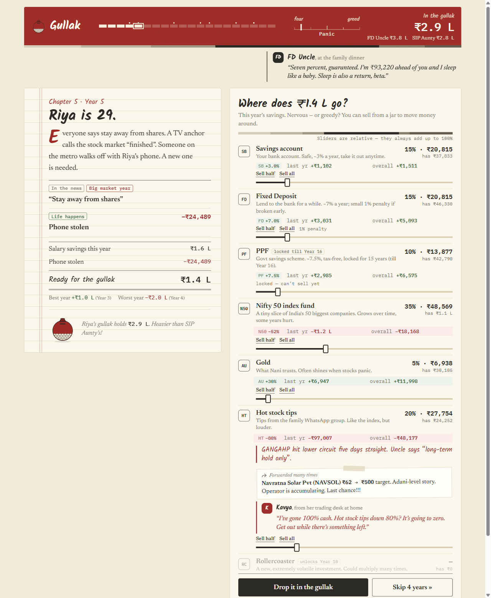

# Gullak 🏺

*A storybook about 20 years of your money.*



Gullak is the clay piggy bank every Indian kid had. In this game you get one: you're 25, and each chapter is a year of your life: twenty years in all. The years are hidden (just Year 1 to Year 20), so you can't game history you remember. It's revealed at the end. Every year your savings arrive, life happens (a cousin's wedding, a medical bill, a Diwali bonus, a layoff), the markets do what they actually did, and you decide where the money goes.

At 45 the gullak cracks open. You're ranked against **FD Uncle**, who kept everything in fixed deposits, and **SIP Aunty**, who put every rupee into a Nifty 50 index fund. Then you get three takeaways drawn from your own run.

Inspired by NGPF's [Build Your Stax](https://buildyourstax.com/), re-imagined for India.

## How it plays

- **20 chapters (Year 1 to Year 20):** split each year's savings across 6 options:

  | Option | What it is |
  |---|---|
  | Savings account | Safe, low return |
  | Fixed deposit | Safe, small penalty if you break it early |
  | PPF | Government savings scheme, locked for 15 years |
  | Nifty 50 index fund | Follows the market |
  | Gold | Tends to rise in a crisis |
  | Hot stock tips | Risky |

- **Real history, in disguise:** the markets follow what actually happened in India from 2005 to 2024, using approximate real yearly returns. The news cards hint at events without naming them, and the end screen reveals which 20 years you just lived.
- **Life events and the emergency-fund lesson:** if you can't cover an expense, you're forced to sell investments, at a loss if the timing is bad. If that's not enough, the rest goes on a credit card at 18%.
- **Family decisions you can't dodge:** your own wedding (big fat, respectable or court marriage), the car, your sister's wedding, Papa's surgery. If you can't afford it, choose: sell investments, or swipe the credit card at 36% a year.
- **The lottery:** you win the Diwali bumper, minus 31.2% tax. Then Mama-ji's business idea, forty new cousins, and a lifestyle upgrade that eats your savings forever arrive.
- **Fear and greed:** Sharma-ji (15 years in the market), Arvind on TV, Kavya the full-time trader and WhatsApp-forward hot tips all comment on the asset you're looking at. They're timed against real history, so the panic calls land before rebounds.
- **⏩ Fast-forward:** skip up to 5 years with a recap. It stops before big market events so you can react.
- **Same seed, same 20 years:** add `?seed=42` to the URL so friends play the identical game.

## Run it

No build step, no backend, no API keys.

```bash
cd gullak && python -m http.server 5175
```

Then open http://localhost:5175.

## Tests

```bash
node --test tests/
```

## Data note

Market returns are approximate calendar-year figures for Nifty 50 (price), gold in INR. This is an educational game, not financial advice.

## Built at

A 2-hour Claude hackathon (fun track), 2026-10-10, built with Claude Code.
